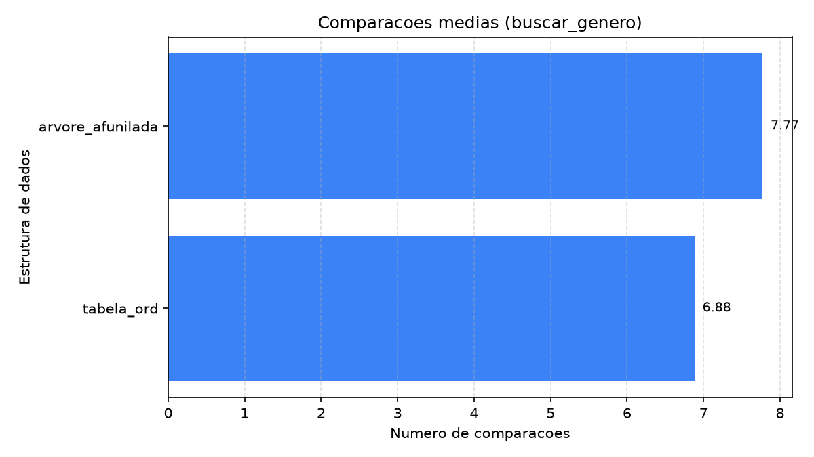
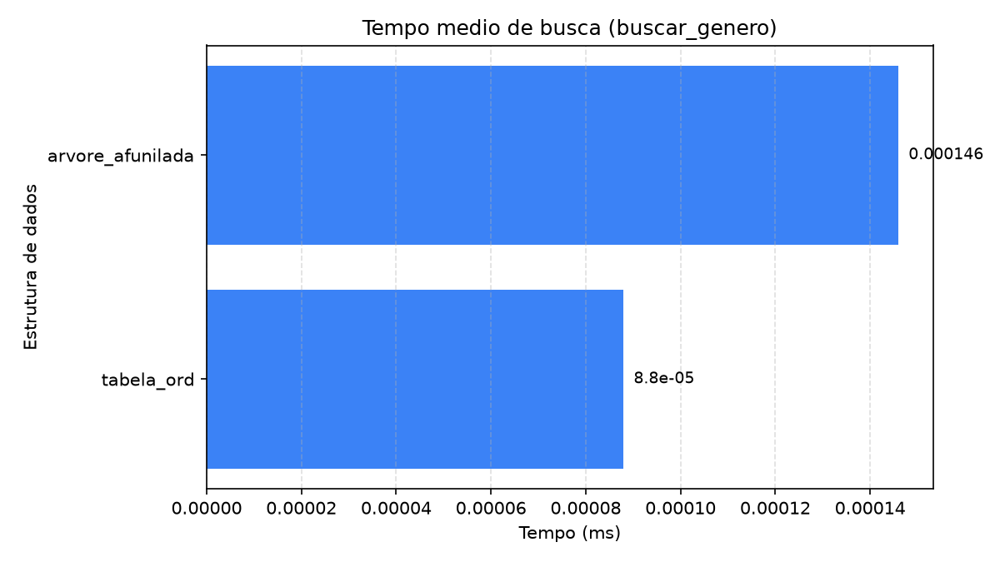
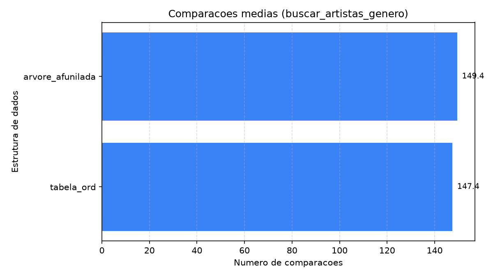
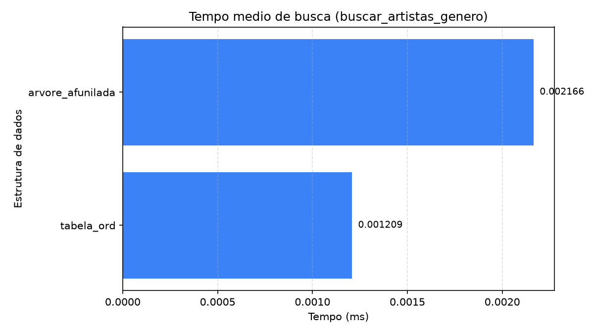
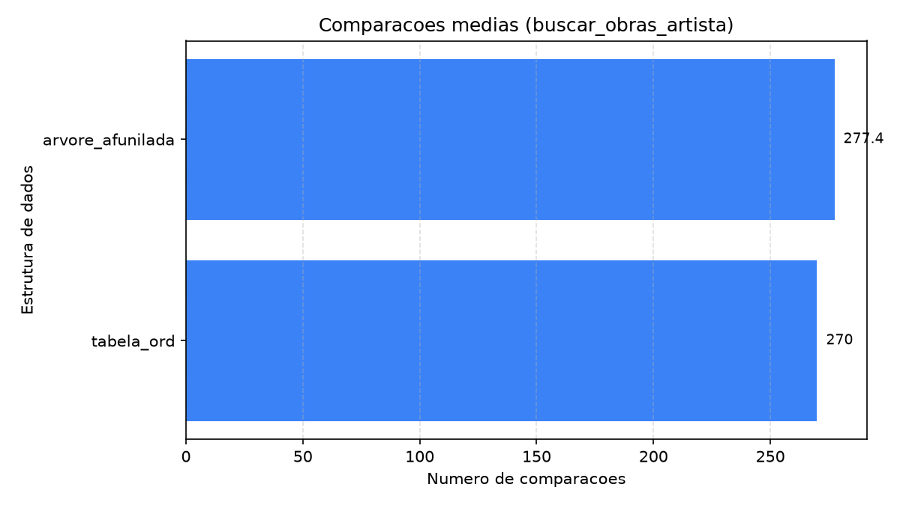
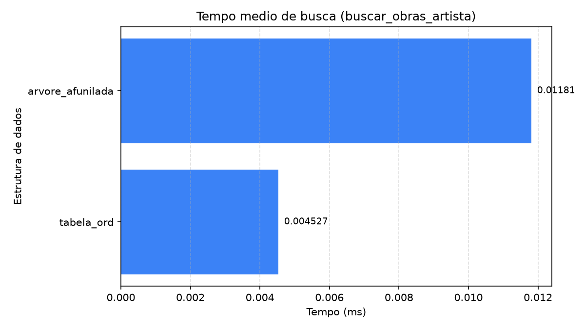
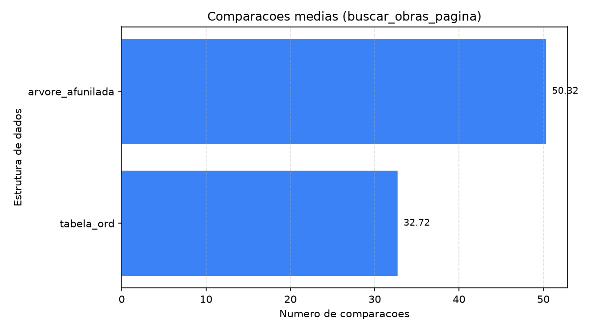
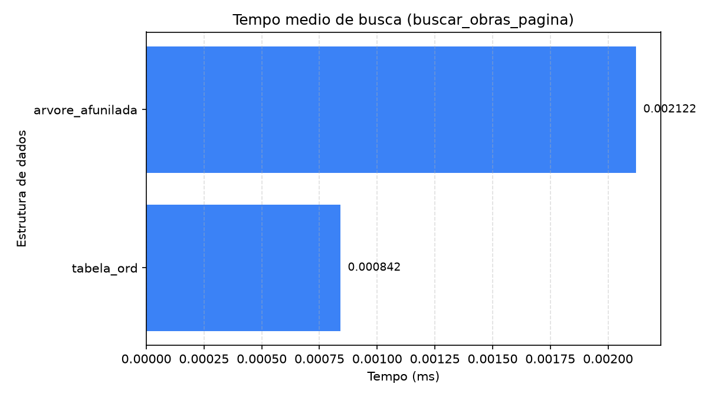
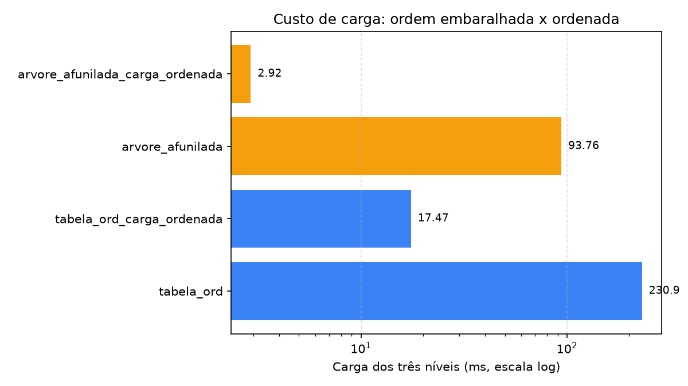
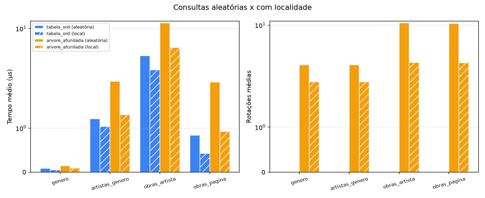

Análise completa do benchmark das duas estruturas (resumo no [README](../README.md)). Para refazer os gráficos, veja "Benchmark" no README.

# Resultados

Benchmark sobre 80.042 obras, com 10.000 buscas por operação, em três cenários:

- **Consultas aleatórias:** cada busca sorteia uma obra e usa a chave dela até o nível medido, então gêneros e artistas pesam na proporção do acervo, como numa navegação real.
- **Consultas com localidade** (sufixo `_local`): uma sessão de navegação que se demora em poucas obras. 8 obras ficam em foco, 90% das consultas caem nelas, e o foco muda a cada 250 consultas.
- **Carga clássica** (sufixo `_carga_ordenada`): a mesma estrutura carregada na ordem das chaves, sem o embaralhamento que o sistema usa.

Todas as estruturas respondem exatamente à mesma sequência de consultas. Dados brutos em [`bench_80k.csv`](bench_80k.csv).

## Consultas aleatórias

| Estrutura | Operação | Tempo médio (µs) | Comparações médias | Rotações médias |
|---|---|---|---|---|
| tabela_ord | buscar_genero | **0,09** | **6,88** | 0 |
| tabela_ord | buscar_artistas_genero | **1,21** | **147,44** | 0 |
| tabela_ord | buscar_obras_artista (todas as obras) | **4,53** | **270,00** | 0 |
| tabela_ord | buscar_obras_pagina (30 obras) | **0,84** | **32,72** | 0 |
| tabela_ord | buscar_obras_pagina_qualquer (30 obras, posição sorteada) | **0,94** | **32,72** | 0 |
| arvore_afunilada | buscar_genero | 0,15 | 7,77 | 3,24 |
| arvore_afunilada | buscar_artistas_genero | 2,17 | 149,44 | 3,25 |
| arvore_afunilada | buscar_obras_artista (todas as obras) | 11,81 | 277,40 | 10,68 |
| arvore_afunilada | buscar_obras_pagina (30 obras) | 2,12 | 50,32 | 10,50 |
| arvore_afunilada | buscar_obras_pagina_qualquer (30 obras, posição sorteada) | 2,77 | 50,46 | 10,54 |

| Comparações médias | Tempo médio |
|---|---|
|  |  |
|  |  |
|  |  |
|  |  |

Uma linha por operação: gênero, artistas do gênero, obras do artista e primeira página de obras.

**Busca de um gênero.** A tabela faz 6,88 comparações: busca binária sobre 27 itens (log₂ 27 ≈ 4,75) mais as duas da coleta. A árvore faz 7,77, e as 3,24 rotações dizem a profundidade média em que o gênero estava. Uma árvore perfeitamente balanceada de 27 nós tem profundidade média 3,04, e a afunilada chega perto disso sem balancear nada, porque as consultas são enviesadas: 38% delas caem em Impressionism, Realism e Romanticism, e a entropia da distribuição é 4,07 bits, contra os 4,75 de uma uniforme.

**Busca dos artistas de um gênero.** Quase tudo é coleta: o gênero sorteado tem em média 135 artistas, e as duas estruturas pagam uma comparação por artista coletado (147,44 contra 149,44).

**Busca das obras de um artista.** As comparações quase empatam (270,00 contra 277,40), porque o bloco médio tem 251 obras e a coleta domina nas duas. O relógio não empata: 4,53 µs da tabela contra 11,81 µs da árvore, 2,6x. É localidade de memória. A tabela percorre um array contíguo, e a árvore salta entre 80 mil nós espalhados pelo heap, andando de sucessor em sucessor, e ainda faz 10,68 rotações por busca.

## Comparação com o algoritmo clássico

Cada modificação foi medida contra o comportamento que o algoritmo clássico teria.

### Busca paginada contra coletar o intervalo inteiro

O clássico devolve o intervalo todo (`buscar_obras_artista`, 251 obras em média); a versão modificada devolve só uma página. Pedir 30 obras faz a árvore cair de 11,81 para 2,12 µs (5,6x) e de 277 para 50 comparações, e a tabela de 4,53 para 0,84 µs (5,4x) e de 270 para 33. O ganho se mantém com a página em posição sorteada dentro do intervalo (`buscar_obras_pagina_qualquer`): 2,77 µs na árvore e 0,94 µs na tabela. Na árvore, isso só é possível porque cada nó guarda o tamanho da subárvore, o que dá o nó de partida da página por seleção em O(altura), sem percorrer os itens anteriores. O preço é um `int` a mais por nó (de 32 para 40 bytes com o alinhamento). A árvore continua 2,5x mais lenta que a tabela, porque a localidade de memória não muda.

### Carga embaralhada contra carga na ordem das chaves

| Estrutura | Carga dos três níveis (ms) | Obras do artista: tempo (µs) | Rotações médias |
|---|---|---|---|
| tabela_ord, carga embaralhada | 230,94 | 4,53 | 0 |
| tabela_ord, carga ordenada | **17,47** | 4,74 | 0 |
| arvore_afunilada, carga embaralhada | 93,76 | 11,81 | 10,68 |
| arvore_afunilada, carga ordenada | **2,92** | **6,97** | 25,78 |

O resultado é menos favorável ao embaralhamento do que se esperava, e vale dizer com clareza:

- **A carga ordenada é muito mais barata nas duas estruturas** (32x na árvore, 13x na tabela). Na tabela, isso é o efeito descrito em aula: inserir sempre no fim não desloca nada, e o custo Θ(n²) só aparece quando a ordem de chegada é aleatória, que é o que o embaralhamento produz. A vantagem de 2,5x da árvore na inserção (94 ms contra 231 ms) existe só com a carga embaralhada; na ordenada, as duas cargam em milissegundos.
- **A carga ordenada deixa a árvore mais rápida em regime**, apesar de a forma ser pior (25,78 rotações por busca contra 10,68): os nós ficam alocados em ordem de chave, e o percurso de sucessor em sucessor anda pela memória em sequência.
- **O que o embaralhamento evita é o começo.** Carregada em ordem, a árvore é uma lista encadeada, e as primeiras buscas são caras até ela se reorganizar:

| Buscas de obras do artista | Tempo médio, carga embaralhada | Tempo médio, carga ordenada | Rotações médias, carga ordenada |
|---|---|---|---|
| primeiras 10 | 0,016 ms | 0,406 ms | 9.559 |
| primeiras 100 | 0,018 ms | 0,062 ms | 1.358 |
| 10.000 | 0,012 ms | 0,007 ms | 25,78 |

(`./wikiart_server data/metadados.csv --bench 10` e `--bench 100`.) São menos de meio milissegundo nas primeiras buscas, que ninguém percebe ao navegar. O embaralhamento troca 91 ms de carga na subida do servidor, e um pouco de desempenho em regime, por uma árvore que já começa equilibrada. É uma escolha defensável para latência previsível, mas não um ganho de desempenho.

## Consultas com localidade

| Estrutura | Operação | Tempo aleatório (µs) | Tempo com localidade (µs) | Rotações aleatório → local |
|---|---|---|---|---|
| tabela_ord | buscar_genero | 0,09 | 0,06 | 0 |
| tabela_ord | buscar_obras_artista | 4,53 | 3,02 | 0 |
| tabela_ord | buscar_obras_pagina | 0,84 | 0,43 | 0 |
| arvore_afunilada | buscar_genero | 0,15 | 0,10 | 3,24 → 2,01 |
| arvore_afunilada | buscar_obras_artista | 11,81 | 5,75 | 10,68 → 3,47 |
| arvore_afunilada | buscar_obras_pagina | 2,12 | 0,93 | 10,50 → 3,44 |

A árvore se adapta como a teoria diz: com o foco estável, o que é mais consultado fica perto do topo, as rotações por busca caem a um terço (10,68 → 3,47) e a busca de obras fica 2,1x mais rápida (11,81 → 5,75 µs). Mas **a tabela também melhora** (4,53 → 3,02 µs), porque as mesmas poucas regiões do array ficam no cache do processador, e continua mais rápida que a árvore (1,9x nas obras do artista, 2,2x na página). As comparações da árvore quase não mudam nos níveis com muita coleta (149,44 → 150,21 nos artistas do gênero), porque coletar domina o esforço. Ou seja: a localidade ajuda a árvore, mas não a faz superar a tabela neste acervo.

## Inserção

Com a carga embaralhada, a árvore carrega os três níveis (27 + 2.082 + 80.042 itens) em 94 ms contra 231 ms da tabela, 2,5x mais rápida: é a diferença entre O(log n) amortizado e O(n), porque cada inserção no meio do array desloca em média metade da cauda, enquanto a árvore só desce e religa ponteiros.

## O balanço

- **Tempo de resposta:** a tabela vence em todos os cenários medidos (aleatório, com localidade, paginado), por um fator de 1,7x a 2,6x, sobretudo por localidade de memória.
- **Adaptação:** só a árvore se reorganiza com o uso, e isso é medido (rotações 3x menores e busca 2,1x mais rápida com localidade), mas não basta para passar a tabela.
- **Inserção com ordem de chegada aleatória:** a árvore vence (2,5x). Com chegada em ordem, as duas são baratas.
- **Na interface:** como o índice é montado uma vez e consultado a cada navegação, a tabela é o padrão. A árvore entra como a vista que mostra a estrutura trabalhando.
